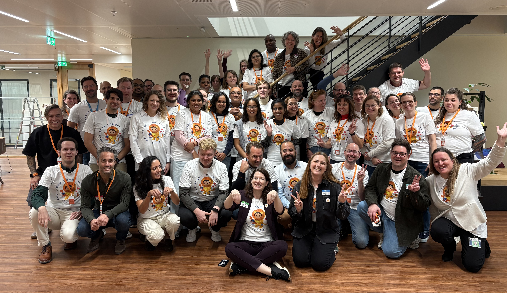
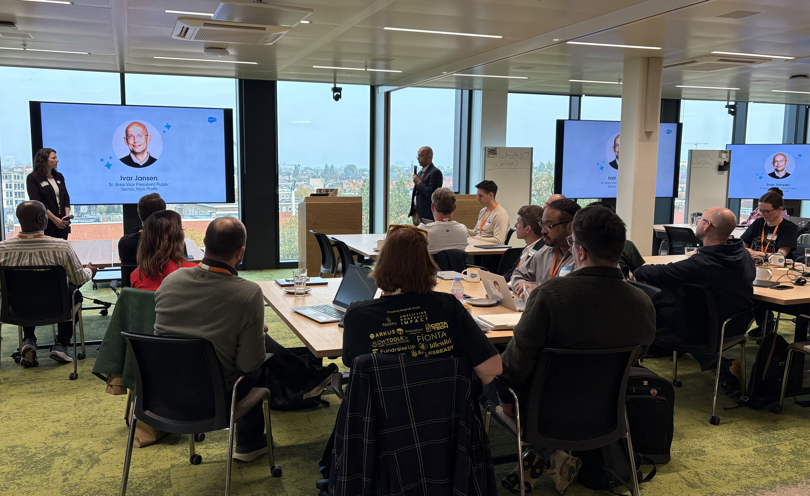
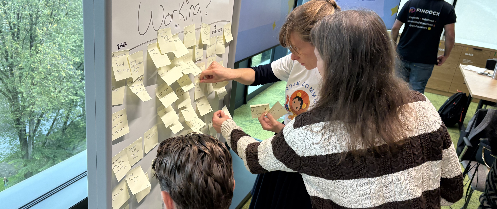
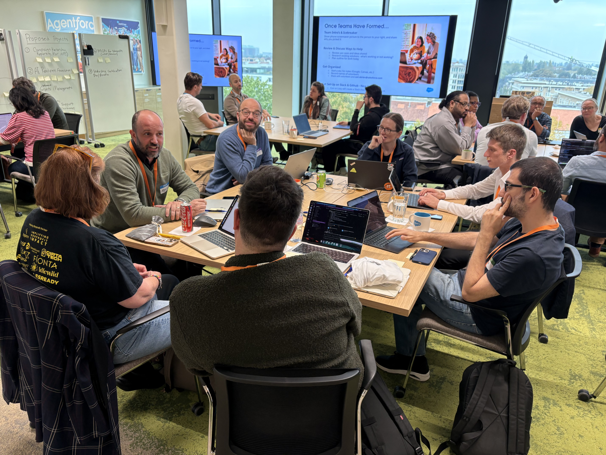

### Dates: 19-20 October, 2026
### Location: Amsterdam, Netherlands

# Amsterdam Community: Thank you for joining us at the Sprint!

_"As always, it was incredibly encouraging and informative to be in the same room with so many brilliant humans dedicated to making the world a better place."_ - Amsterdam Sprinter

**46 custmers & parnters** and **18 Salesforce staff** (64 total!) joined us in person for the 2-day Sprint, representing the local **Nonprofit ecosystem**, including end users, admins, developers, architects, and industry partners from the Netherlands and beyond.

_Group Photo, Amsterdam, 2026_

To everyone who joined: **thank you** for carving out time during what we know is an already busy time of year. Your willingness to share your skills, insights, and energy made this event truly exceptional.

**80%** of the room were NEW sprinters (!) and our returning leaders rose to the occasion beautifully, mentoring newcomers and creating the collaborative, welcoming atmosphere that defines our community.

## A Welcome from Salesforce Leadership 
After a lively networking breakfast, [Cori O'Brien](https://www.linkedin.com/in/coriobrienpaluck/) (Director, Nonprofit Community) officially kicked off the day, our master emcee! We had welcome remarks from [Ivar Jansen](https://www.linkedin.com/in/ivarjansen/) (SVP, EMEA, Nonprofit at Salesforce), sharing deep gratitude for the strength and dedication of this regional community.

_Leadership Welcome Address, Amsterdam, 2026_

## Let’s Sprint!
After breakfast and intros, it was time to get to work. Attendees had the option to join 3 existing project and 2 brand-new projects on the spot. Collaboration kicked off quickly, with creative energy flowing.

After a quick round of project identification based on prioritized challenges they are faced with today, attendees moved around the room to join the projects that resonated most with their interests and expertise. Collaboration was officially underway - and the creative energy was palpable.

_Innovation exercise, Amsterdam, 2026_

## What Was Built: Project Highlights

Check out the 5 Community-Led projects that participated:

_In alphabetical order_

1. **AI Readiness Assessment**
2. **Gift Aid**
3. **Migration Support Discovery**
4. **Summit Events App**
5. **Unsubscribe Link**

---

## **1. AI Readiness Assessment**

A new project building an AI readiness checklist so organizations can assess how prepared they are for AI.

**Work performed at this sprint:**
- Set the goal, risks and desired outputs for the AI readiness checklist
- Built an initial mock-up, refined the demo and set up a working prototype Assessment App in a scratch org to try
- Developed user stories, assessment criteria and testing scripts
- Gathered Trailhead context and contacted Salesforce third parties for AI readiness insights

**Next Steps:**
- Refine the assessment criteria and what the testing scripts cover
- Decide on the interface for user inputs
- Formalize roles and sharpen the goal of the framework
- Look into maintainability

Learn more: Follow along in the [project GitHub repository](https://github.com/SFDO-Community-Sprints/Salesforce-nonprofit-AI-readiness).

Team lead: Fergal Hayes & Rimon Hanna

Team members: Fenik Arroyo, Donato Cinque, Ankit Bhimjiyani, Mantu Bhuyar, Kyrylo Mazur, Dirk-Jan Ansing, Monique Erinna, Ana Campos

---

## **2. Gift Aid**

Gift Aid is a UK scheme that lets registered charities reclaim basic-rate tax on donations from UK taxpayers, boosting the value of a donation by 25% at no extra cost to the donor. This free, open-source Salesforce package helps UK charities manage the full Gift Aid lifecycle, from capturing declarations to exporting HMRC-ready claims.

**Work performed at this sprint:**
- Refined requirements, removed redundant user stories and split up the work
- Redesigned the core data model for separated periods and added a new claim object
- Built automations to link and unlink opportunities to claim periods, mark opportunities ineligible, and store the last known address
- Added start date calculation, a reusable UK postcode subflow, an ERD, a process flow, data quality reports and a new Gift Aid section on the Contact record

**Next Steps:**
- Make progress on and complete the user stories
- Create new issues for further development and reorganise existing ones
- Finish the outstanding items

Learn more: Follow along in the project [GitHub repository](https://github.com/SFDO-Community-Sprints/gift-aid) and [wiki](https://github.com/SFDO-Community-Sprints/gift-aid/wiki).

Team lead: Jose Carlos De Oliveira

Team members: Rama Injety, Abdullah Bayrakdar, Gayathri Srinivasan, Luciana Magnani, Maria Kurbatova, Kola Ayenitaju

---

## **3. Migration Support Discovery**

A project exploring how to support organizations migrating from NPSP to NPC. The discovery discussion concluded that a migration this complex is best left in the hands of Salesforce. Work shown here is Day 1 only.

**Work performed at this sprint:**
- Identified the gaps to migrate
- Defined the persona

**Next Steps:**
- Share the discovery findings (gaps and persona) with Salesforce, who are best placed to own the migration

Team members: Jesse Hoosemans, Marie van Roekel, Sindhuja, Vaner Menon, Auke Jutjens

---

## **4. Summit Events App**

Summit Events App (SEA), built by members of the Salesforce.org Commons community, is a free end-to-end event management solution for the education and nonprofit community. This team extended it to support targeted event invitations using Salesforce Campaigns and Campaign Members.

**Work performed at this sprint:**
- Set up Slack, GitHub and full sandbox access, plus a GitLab and AI content pack
- Wrote the user stories for the invitation lifecycle
- Built and deployed to the sandbox the first user stories: linking the invitation Campaign to the Gala event, a donor type field, a Campaign Member trigger and duplicate registration prevention
- Created a recipe for organisers of private events: Campaign Members trigger registration records with personalised registration links, and invitees get an email to RSVP and complete the standard registration journey

**Next Steps:**
- Strengthen the Email/Marketing Cloud solution
- Sync Campaign Members with registration records
- Decide which functionality to include in Core SEA

Learn more: [Summit Events App](https://install.salesforce.org/products/SummitEventsApp)
Follow along in the original [Summit Events App repository](https://github.com/SFDO-Community/Summit-Events-App) and the [Amsterdam Sprint extensions repository](https://github.com/cmlcs/Summit-Events-Extensions).

Team lead: Pieter Kop

Team members: Andre van Kampen, Katarzyna Jarosz, Jelena Vladusic, Bhuvana Lakshmi Narayana, Yuliia Vovk, Peter Van Der Meij, Lara Wong

---

## **5. Unsubscribe Link**

Any promotional or fundraising email sent from Salesforce should give recipients a way to unsubscribe, but native Salesforce doesn't provide that feature. Unsubscribe Link is a community-built app that fills that gap, and the team worked to get it ready for its V1 release.

**Work performed at this sprint:**
- Reviewed the package architecture, flagged and documented potential security risks (including open email entry) and raised pull requests with fixes
- Created installation instructions for contributors (unlocked package) and updated end user instructions (managed package)
- Completed LWR site testing, made recommendations and updated documentation
- Got the AgentExchange launch template half done and proposed a project name change (subject to a vote from project leaders)

**Next Steps:**
- Finish the AgentExchange launch template
- Meet with project leads and contributors on v1 release readiness
- Finalise and QA the release
- Submit for Salesforce Security Review

Learn more: [Unsubscribe Link](https://appexchange.salesforce.com/appxListingDetail?listingId=a0N3A00000FMkfNUAT)

Team lead: Richard Ivan

Team members: Melissa Hill Dees, Ralf de Groot, Justyna Krajewska, Ruben Halman, Emre Ozman, Abdelhakim Mouttaqui

_Project time, Amsterdam, 2026_

---

**WOW - what an incredible amount of work to get done in just. two. days.** We're constantly amazed by the brilliance, generosity, and grit this community brings.

## What's Next?

**PHEW! That was a lot! So much innovation is taking place. But it doesn't stop here!**

**Register or save the date for our upcoming events:**

- November 9-10: [San Francisco Community Sprint](https://invite.salesforce.com/sanfranciscocommunitysprint)
- ...and more to come as we get more confirmed!

See all confirmed events in the [Sprint group](https://trailhead.salesforce.com/trailblazer-community/groups/0F94S000000GwVKSA0).

Follow our [Salesforce Nonprofit Community](https://www.linkedin.com/company/salesforce-nonprofit-community) page on LinkedIn to stay in the loop! 

See you soon!

Nonprofit Community Team, [Cori O'Brien](https://www.linkedin.com/in/coriobrienpaluck/), [Lizzy Roberts](https://www.linkedin.com/in/lizzyroberts/) and [Natalie Larino](https://www.linkedin.com/in/natalie-larino/)
